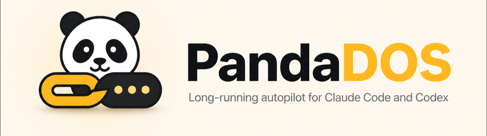
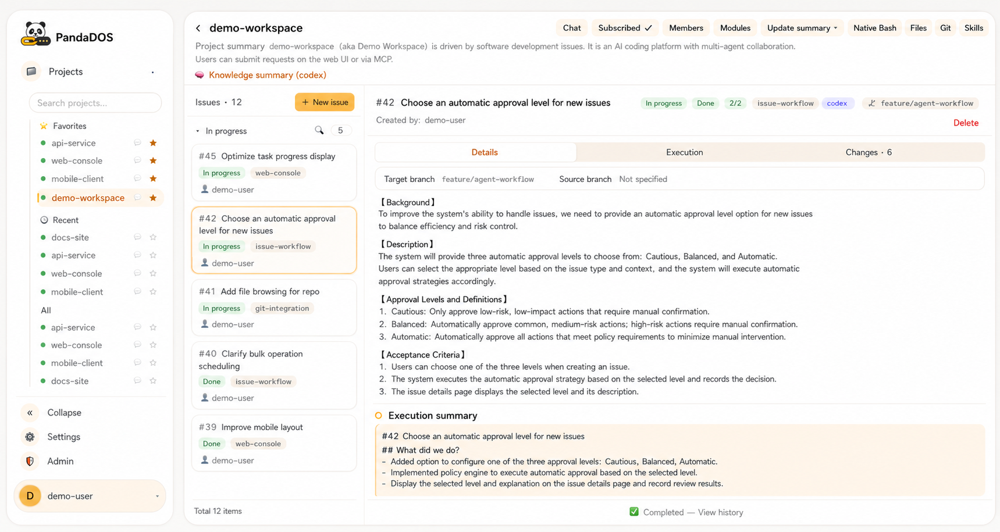
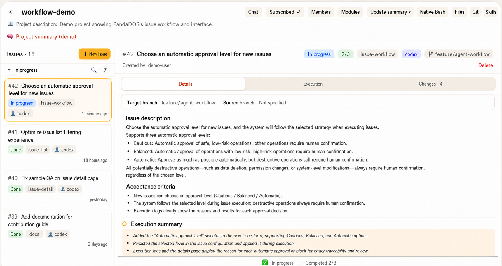

# PandaDOS — Claude Code と Codex のための長時間稼働するオートパイロット

<p align="center">
  
</p>

PandaDOS は、Claude Code と Codex を、長時間稼働する issue 駆動のコーディングエージェントに変える、オープンソースでセルフホスト型の
コントロールプレーンです。あなたは目指す成果を定め、プロダクトやアーキテクチャの重要な判断を下します。PandaDOS はキューを進め、
コンテキストを保ち、日常的な承認を処理し、進捗を見守り、
結果を記録し、本当に判断が必要なときだけ
あなたを呼び戻します。

[English](README.md) · [简体中文](README.zh-CN.md) · 日本語

[PandaDOS を使う理由](#pandados-を使う理由) · [クイックスタート](#クイックスタート) ·
[最初の 10 分](#最初の-10-分) · [仕組み](#仕組み) ·
[24 時間 365 日の運用](#pandados-を-24-時間-365-日動かす) · [セキュリティ](#セキュリティ)



> スクリーンショットに写っているワークスペース、ユーザー、issue、ブランチ、プロジェクト名は、伏せ字処理したデモ用の
> データです。

## PandaDOS を使う理由

Claude Code と Codex は優れたネイティブのコーディングエージェントです。PandaDOS はそれらを置き換えたり、
そのターミナルを隠したりはしません。そのまわりに、オペレーティングシステムを加えるものです：

- **作業は、何度も繰り返すチャットのプロンプトではなく、issue で進みます。** 成果、受け入れ条件、
  優先度をキューに入れれば、エージェントが計画、実装、検証、
  納品へと進み続けます。
- **長時間の自動化も見えるままです。** 本物の Claude Code や Codex の会話、
  ターミナル、ファイル、Git の変更、承認、実行のまとめを、ブラウザーやスマートフォンから追えます。
- **日常的な確認に一日を取られなくなります。** 承認は慎重、バランス、自動から選べます。
  安全で元に戻せる作業は自動で続けられ、破壊的なもの、元に戻せないもの、
  本番環境に関わるもの、秘密情報に関わるもの、本当にあいまいな判断は、引き続きあなたのもとに戻ってきます。
- **コンテキストは 1 つのタスクを越えて残ります。** プロジェクト、モジュール、再利用できるエージェントの会話、issue の
  まとめ、リポジトリの知識が、あとの作業に長く使える出発点を与えます。
- **キューは進み続けます。** PandaDOS は、依頼を明確にし、実行し、中断のあとで回復し、
  プロジェクトの方針に従ってコミットと push を行い、結果をまとめて、役に立つコンテキストを
  次の issue に引き渡せます。

目的は、ソフトウェア開発から人を取り除くことではありません。
絶え間ない監督からあなたを解放し、
プロダクトの方向性、システムの設計、レビュー、そして本当に判断が必要な決定に集中できるようにすることです。

## クイックスタート

### おすすめの構成

ときどきローカルで使うなら、Mac か Linux のワークステーションで PandaDOS を動かしてください。継続して動かすなら、
常にオンラインの小さなクラウドホストを使い、PandaDOS をシステムサービスとして動かし、ローカルまたは
リモートの実行機を SSH で接続します。こうすれば、ノート PC を閉じている間も issue のキューが進み続けます。

コントロールプレーンには、Bun、Git、tmux、書き込み可能な `~/.panda/` が必要です。どの実行機にも、Git、
tmux、認証済みの Claude Code または Codex の CLI が必要です。明確化、PM としての判断、まとめ、承認の説明のために、
OpenAI 互換のドライバーモデルを強くおすすめします。

### Claude Code や Codex にインストールを頼む

PandaDOS を動かしたいマシンで、次のプロンプトを Claude Code か Codex に貼り付けてください：

```text
Install the latest stable PandaDOS release for me from
https://github.com/uniquechao/PandaDOS/releases.

Before changing anything:
1. Inspect the operating system, current user, available ports, Bun, Git, tmux, Claude Code, Codex,
   systemd, and any existing reverse proxy.
2. Query the latest non-draft, non-prerelease GitHub Release and detect the machine architecture.
   Select exactly one matching asset: macOS arm64 -> macos-arm64, macOS x86_64 -> macos-x64,
   Linux aarch64/arm64 -> linux-arm64, or Linux x86_64/amd64 -> linux-x64. Never substitute an
   asset built for another operating system or architecture.
3. Download the matching `PandaDOS-v*-<platform>.tar.gz` and `SHA256SUMS` from the same Release.
   Verify the archive against its exact SHA-256 entry before extracting it.
4. After extraction, read ARTIFACT.md, README.md, and DEPLOY.md and use them as the source of truth.
5. Explain the exact installation plan and ask before any destructive change, firewall change,
   package removal, or replacement of an existing service or proxy configuration.

Then:
- Install the verified bundle in a dedicated versioned directory and start it with `./bin/pandados`.
- Preserve an existing `~/.panda/`, service definition, reverse proxy, and active tmux agent processes
  when upgrading.
- The bundle already contains the prebuilt UI and production dependencies. It still requires Bun,
  Git, tmux, and an authenticated Claude Code or Codex CLI; install only missing prerequisites.
- If no compatible Release asset exists, stop and explain why. Ask before falling back to cloning
  the source repository and running the full build.
- Keep PandaDOS bound to 127.0.0.1:8802.
- Start it and verify /healthz.
- If systemd is available, install a restart-on-failure service using the DEPLOY.md example and
  preserve tmux agent processes when the control plane restarts.
- If remote access is requested, configure a trusted nginx or Caddy reverse proxy with TLS,
  authentication, and WebSocket forwarding. Never expose port 8802 directly to the public internet.
- Tell me where the one-time admin token was written, but do not print, upload, or transmit secrets.
- Finish with the login URL, service status, health-check result, and any manual steps still needed
  to authenticate Claude Code or Codex.
```

リリースのバンドルには、ビルド済みの UI と、ターゲットに応じた本番用の依存関係が含まれています。Bun、Git、tmux、Claude Code、
Codex は同梱していません。

### 手動でインストールする

```bash
git clone https://github.com/uniquechao/PandaDOS.git
cd PandaDOS
bun install --frozen-lockfile
bun run check-i18n
bun run typecheck
bun test
bun run build-ui
bun run start
```

`http://127.0.0.1:8802` を開きます。初回の起動時に、PandaDOS は管理者アカウントを作成し、
その 1 回限りのトークンをモード `0600` で `~/.panda/admin-token` に書き込みます。

systemd、リバースプロキシ、環境変数、SSH の実行機、ヘルスチェック、日常の運用については、
[DEPLOY.md](DEPLOY.md) に従ってください。

## 最初の 10 分

1. **サインインします。** 初回の起動時に作成された、1 回限りの管理者トークンを使います。
2. **実行機を確認します。** 「管理」で、常時稼働のホストや SSH のマシンが、
   Claude Code や Codex の CLI と、その認証済みの状態を見つけられることを確認します。
3. **ドライバーモデルを設定します。** PM による明確化、まとめ、承認の説明、プロジェクトの理解を使いたい場合は、
   「管理」で OpenAI 互換のエンドポイントを追加します。
4. **既存の作業を取り込むか、プロジェクトを作成します。**
   - **Import** を選び、Claude か Codex を選んで、既存のローカルのプロジェクトを選ぶと、その
     作業ディレクトリと、利用できる会話の履歴が取り込まれます。
   - すでに動いているセッションを登録するには、tmux を選びます。
   - Git リポジトリをクローンするか、空のワークスペースを作成するには、**New project** を選びます。
5. **作業のしかたを選びます。**
   - キューに入れて追跡できる形で納品するには、**issue プロジェクト** を使います。成果、
     関連するコンテキスト、受け入れ条件を書いた issue を作成すると、PandaDOS が実行の各段階を処理します。
   - 探索的な作業や一度きりの変更には、**チャットプロジェクト** を使います。会話を作成し、issue のキューを使わずに、
     Claude Code や Codex と直接作業します。
6. **承認のレベルを設定します。** バランスモードから始め、PandaDOS が何を自動で承認するかを確認し、
   リポジトリと実行機が適切に分離されている場合にだけ、自動化の度合いを上げてください。
7. **キューを動かしたままにします。** ブラウザーやスマートフォンから見守り、本当に必要な明確化の
   依頼に答え、残りの時間を設計とレビューに使ってください。

## 仕組み

```text
You define outcomes and priorities
                │
                ▼
      PandaDOS issue queue and PM
                │
                ├── clarify missing requirements
                ├── plan and choose an agent
                ├── apply approval policy
                ├── observe progress and recover
                └── summarize and hand off
                │
                ▼
       Local or SSH executor
                │
                ▼
          tmux session
                │
                ▼
       Claude Code or Codex
```



各 issue は、追跡できる作業の単位です。独立したプロジェクトは別々に実行でき、1 つの
リポジトリを共有する作業は、編集の衝突を減らすために順番に実行されます。モジュールには、担当のエージェントを 1 つ割り当て続けられます。
issue の会話は通常ローテーションします。`MODULE.md` にあるモジュールの知識が
issue をまたいだ継続性を与え、終わっていない会話は再開できます。

### 承認と安全のモデル

- **慎重** は、自動での承認を最小限にします。
- **バランス** は、よくある安全で元に戻せる開発の操作を自動で受け入れます。
- **自動** は、日常的な作業が最小限の中断で続くようにします。
- 承認のポリシーは、破壊的なエージェントのメニューやあいまいなメニューをエスカレーションします。実際の境界は、
  CLI のサンドボックスと実行機のアカウントにも左右されます。ブラウザーのターミナルへのアクセスは、そのアカウントの
  シェルの権限を与えます。信頼できないプロジェクトは、別々の実行機のアカウントやマシンで分離してください。

PandaDOS は、2 つ目の実行エンジンを作り出すのではなく、ネイティブのエージェントのセッションを見せます。いつでも
確認して介入できます。

## 得られるもの

- issue のキュー、明確化、計画、実行の各段階、レビューのゲート、結果のまとめ、引き継ぎ
- Claude Code と Codex の能力の検出と、プロジェクト、モジュール、issue の各レベルでの選択
- 長く続くモジュールの会話とプロジェクトの知識
- チャット、ネイティブのターミナル、ファイル、画像、Git の履歴、差分、進捗のためのブラウザーのワークスペース
- ローカルと SSH の実行機
- プロジェクトのメンバー、購読、同じ会社の Feishu でのログイン／連携、プロジェクトについての非公開の Q&A、通知、承認のカード
- 10 の UI の言語。プロダクトの文言はローカライズしつつ、issue、コード、コマンド、パス、
  ターミナルの出力、Git のデータ、既存の会話の履歴はそのまま保ちます

## Feishu との連携

**管理 → Feishu** で会社のアプリを設定すると、同僚が自分のアカウントでサインインし、
ボットとの個別チャットで権限のあるプロジェクトを選び、プロジェクトの PM に質問し、
購読の通知と承認のカードを受け取れるようになります。ログインとメッセージにはそれぞれ独立したスイッチがあり、
管理ページには、認証情報の確認、接続の状態、再接続、そして現在の管理者の連携したアカウントへの
テストメッセージの送信があります。

権限、設定、個別チャットの
コマンド、設定の優先順位、トラブルシューティング、現在の制限については、[Feishu の設定と利用ガイド（中国語）](docs/feishu.md)を参照してください。

## PandaDOS を 24 時間 365 日動かす

長い issue のキューには、常時稼働のデプロイがいちばん合っています：

1. スリープしないクラウドホストなどのマシンを使います。
2. 失敗時に再起動する設定にして、PandaDOS を systemd の下で動かします。
3. HTTP のサービスは `127.0.0.1:8802` のままにします。
4. 前段に、TLS、強力な認証、WebSocket の転送を備えた nginx か Caddy を置きます。
5. 同じホストをローカルの実行機として登録するか、専用の実行機のマシンを SSH で接続します。
6. サービスのアカウントで Claude Code や Codex が認証されていることと、そのワークスペースの
   権限が意図的に制限されていることを確認します。
7. WAL を考慮した SQLite のバックアップ方法で `~/.panda/` をバックアップし、`/healthz` を監視します。

issue が実際にリポジトリを変更している間は、必要でない限りコントロールプレーンを再起動しないでください。
メンテナンスされているサービスと運用のリファレンスは [DEPLOY.md](DEPLOY.md) を参照してください。

## アーキテクチャ

```text
core ← executor ← issues ← agents
  ↑
web / notify
```

| ディレクトリ | 責任 |
| --- | --- |
| `src/core/` | SQLite、マイグレーション、ユーザー、会話、ファイル、スキル、プロジェクトのデータ |
| `src/executor/` | ローカルと SSH の実行機の境界 |
| `src/issues/` | 状態機械、キュー、モジュール、明確化、実行エンジン |
| `src/agents/` | ドライバーモデルのクライアント、PM としての判断、進捗、承認のポリシー |
| `src/notify/` | 購読、集約、通知のチャンネル |
| `src/web/` | HTTP API、WebSocket、ターミナルのブリッジ、サービスの組み立て |
| `ui/` | Preact と Vite によるブラウザーのインターフェース |
| `shared/i18n/` | 型付きのカタログ、ICU のフォーマット、ロケールの照合、タイムゾーンのフォーマット |

実行時のアーキテクチャとモジュールの
境界については、[実行モデル](docs/execution-model.md)を読んでください。

## セキュリティ

PandaDOS は、ターミナル、ファイル、Git の操作、認証済みのコーディングエージェントのセッションを公開する場合があります。
Web インターフェースへのアクセスは、リモートシェルへのアクセスとして扱ってください。

- ポート `8802` をインターネットに直接公開しないでください。
- 信頼できるリバースプロキシで、TLS と強力な認証を必須にしてください。
- `.env` ファイル、データベース、管理者トークン、認証情報、SSH の秘密
  鍵、エージェントのセッションのデータを、コミットしたり送信したりしないでください。
- 最小限の権限を持つ、専用のサービスと実行機のアカウントを使ってください。
- 自動化の度合いを上げる前に、承認のポリシーを確認してください。
- 本番のデータベースの診断は読み取り専用にとどめ、一貫したバックアップを使ってください。

## 開発

```bash
bun run check-i18n
bun run typecheck
bun test
bun run build-ui
```

コントリビュートする前に [AGENTS.md](AGENTS.md) と [CLAUDE.md](CLAUDE.md) を読んでください。

## ライセンス

PandaDOS は [Apache License 2.0](LICENSE) のもとでライセンスされています。
